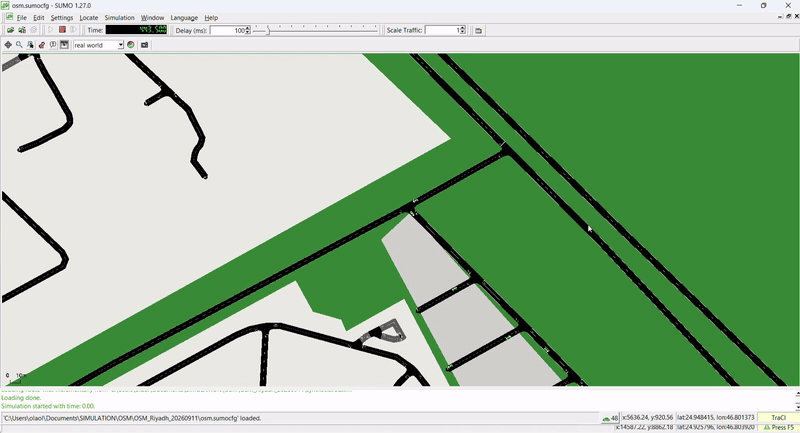
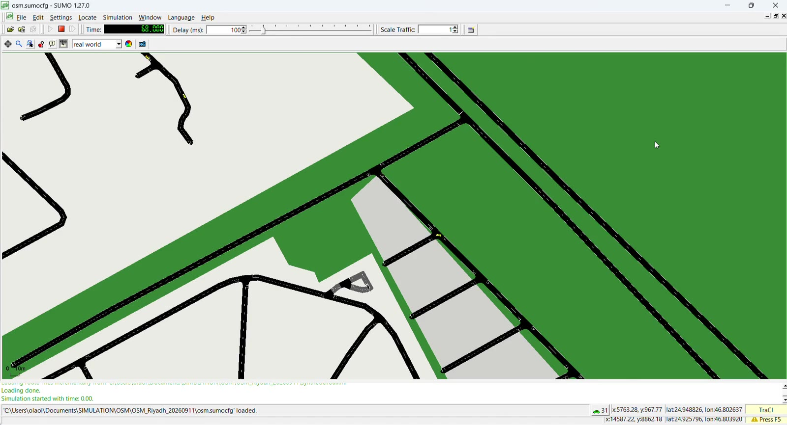
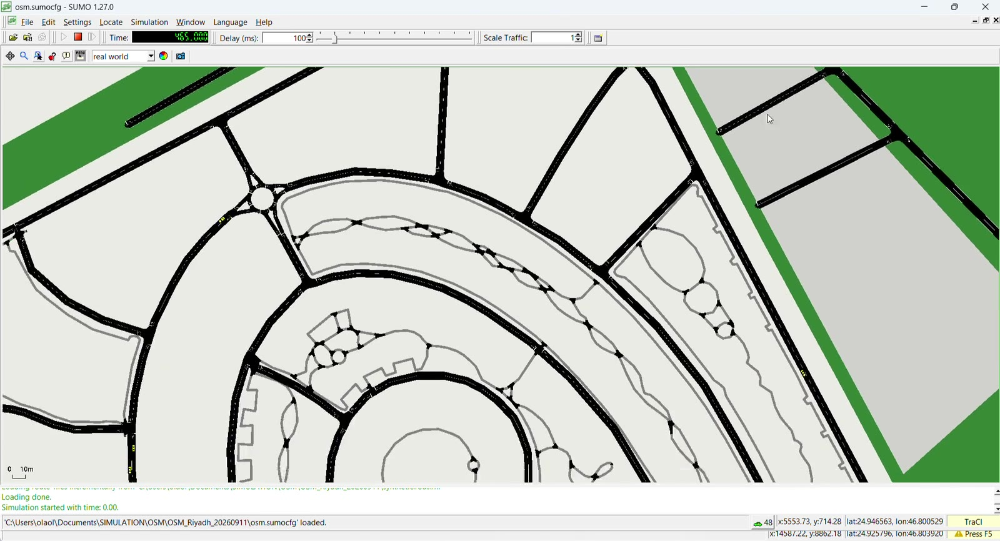

# Riyadh SUMO + TraCI: Synthetic Demand Baseline

SUMO simulation of the Prince Mohammed Ibn Salman Ibn Abdulaziz Road corridor in Riyadh, Saudi Arabia, with synthetic traffic demand and a TraCI script that logs per-vehicle speed and position.

**Status:** Work in progress. Demand is synthetic and **uncalibrated**. No real traffic counts or OD data are used yet.

## Demo

[](assets/demo.mp4)

▶ **[Watch the full demo (87 s, MP4)](assets/demo.mp4)**

Screen recording of `osm.sumocfg` running in `sumo-gui` with the TraCI connection active: the network loads, synthetic vehicles (`synthetic.rou.xml`) are inserted, and cars move along the extracted Riyadh roads. The view is zoomed in, so vehicles appear as small yellow markers.

## Screenshots

| Network loaded, vehicles moving | Routes through a roundabout area |
|---|---|
|  |  |

Both frames come from the demo above. The status bar shows `osm.sumocfg` loaded, `Simulation started with time: 0.00`, the live vehicle count, and the `TraCI` indicator.

## Contents

```
.
├── OSM_Riyadh_20260911/assets/
│   ├── demo.mp4                      # Full demo video (87 s)
│   ├── demo_preview.gif              # Preview shown above
│   ├── sumo_network_vehicles.jpg     # Screenshot
│   └── sumo_roundabout_routes.jpg    # Screenshot
├── OSM_Riyadh_20260911/
│   ├── osm.net.xml.gz         # Road network (from OpenStreetMap)
│   ├── osm.poly.xml.gz        # Buildings/polygons (visual only)
│   ├── osm.view.xml           # GUI view settings
│   ├── output.add.xml         # Additional output definitions
│   ├── synthetic.trips.xml    # Raw random trips
│   ├── synthetic.rou.xml      # Routed vehicles (used by the simulation)
│   └── osm.sumocfg            # SUMO configuration
├── traci_monitor.py           # TraCI script: logs speed/position to CSV
├── .gitignore
└── README.md
```

## Requirements

- [Eclipse SUMO](https://sumo.dlr.de/docs/Downloads.php) 1.27.0 (tested)
- Python 3.8+ (TraCI and sumolib ship with SUMO in `<SUMO_HOME>/tools`)
- `SUMO_HOME` environment variable set to your SUMO install folder
  - Windows example: `C:\Program Files (x86)\Eclipse\Sumo`

## Run

**1. Watch the simulation (no Python):**
```
sumo-gui -c scenario/osm.sumocfg
```
Press the green play button.

**2. Run with TraCI logging:**
```
python traci_monitor.py
```
Output: `traci_speed_position_log.csv` (columns: step, vehicle_id, speed_mps, x, y) saved next to the script.

## Before you run: change this

`traci_monitor.py` (Step 4) contains a hardcoded Windows path to `osm.sumocfg`. Replace it with a path relative to the script:

```python
'-c', os.path.join(os.path.dirname(os.path.abspath(__file__)), 'scenario', 'osm.sumocfg'),
```

If you keep the original absolute path, edit it to match where you cloned the repo.

## Regenerate the synthetic demand

Run from inside `scenario/`:
```
python "%SUMO_HOME%\tools\randomTrips.py" -n osm.net.xml.gz -o synthetic.trips.xml -r synthetic.rou.xml -e 3600 -p 2 --fringe-factor 10 --seed 42 --validate
```
(On Linux/macOS use `$SUMO_HOME/tools/randomTrips.py`.)

| Option | Meaning |
|---|---|
| `-e 3600` | 1-hour demand window |
| `-p 2` | One new trip every 2 s (arbitrary, not calibrated) |
| `--fringe-factor 10` | Favors trips entering/leaving at network edges (through-traffic) |
| `--seed 42` | Reproducible output |
| `--validate` | Drops unroutable trips |

## Known limitations

- Demand is random edge-to-edge, not based on observed counts.
- Planned: calibrate with SUMO `routeSampler.py` once traffic count data is available.
- The network extract may not match the exact corridor length used in the reference papers.

## Reference papers

- Louati, A.; Louati, H.; Kariri, E. Harmonized Autonomous–Human Vehicles via Simulation for Emissions Reduction in Riyadh City. *Future Internet* 2025, 17, 342. https://doi.org/10.3390/fi17080342
- Louati, A.; Louati, H.; Kariri, E. Simulation assessment of autonomous electric vehicles on urban sustainability in Riyadh City. *Scientific Reports* 2026, 16, 9401. https://doi.org/10.1038/s41598-026-40646-9

## Data attribution

Road network derived from OpenStreetMap data, © OpenStreetMap contributors, available under the [ODbL](https://www.openstreetmap.org/copyright).

## Contact

Samuel Abioye
